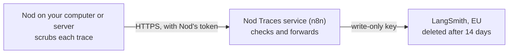

Conversation traces let the Nod team at n8n see how Nod handles real requests, so they can find and fix problems. They're off until you turn them on. Nod masks secret values of at least eight characters that it knows, known secret formats and personal details it recognizes before sending a trace. Short secret values and other private content can remain.

This page describes n8n's trace service, used by official desktop builds. A server operator can configure another receiver; that receiver controls access and retention.


## Turn traces on or off

1. Open **Settings → Privacy & data**.
2. Turn on **Share conversation traces**.

Select **How Nod uses your data** beside the heading for a short summary of both switches.

Turn the switch off to stop sending at once. A trace that was already on its way can still arrive. Traces already sent are deleted when they expire, 14 days after they arrive.

The switch is separate from **Share usage data**, and you can turn either on without the other. It appears for an official local desktop assistant. A source install or self-hosted server needs `NOD_TRACES_TOKEN` and a nonempty receiver URL. `NOD_TRACES_URL` defaults to n8n's service (see [Configuration](/deploy/configuration/#analytics-and-feedback)). A connected desktop client uses the server's trace configuration.

## What a trace contains

While the switch is on, each request Nod makes to your model becomes one trace, from chats, tasks, helpers and background checks.

Each trace can include, after redaction:

- The messages and tool results the model saw, including text Nod read from [local files](/connect/local-files/).
- Nod's instructions, without your saved memory, learned skills and formats.
- The names of the tools the model could use.
- The model's reply, name, token counts and cost.
- Whether the request came from chat, a task, a helper or a background check.

Nod excludes:

- The original Nod session ID in trace metadata.
- Images, which become `[image]`.
- Checks of emails that may give access to an account.
- Requests to decision services.
- Separate requests to the models that write your memory, writing style or learned skills.
- Attention and review tasks.
- Codemode scripts and results.
- Usage analytics, which have their own switch.

Each trace includes the Nod version as `app_version` metadata when a valid release version or source revision is available.

When available, a trace also records the observed request phase. A prepared payload does not prove that the request reached the provider. This field contains no transport headers or request content.

The `request_kind` field distinguishes a one-token cache-warming request (`cache_warm`) from a regular request (`regular`). Regular requests include background checks. Neither kind proves that an owner received a useful result. Older traces without the field have an unknown kind.

n8n's service sees the sending machine's IP address when it receives a trace. For a self-hosted assistant, that is the server's address. It doesn't add the address to the trace.

## What Nod removes first

Every trace passes through these layers on the machine running your assistant before it's sent.

| Layer                       | What it removes                                                                                     | How it decides                                                    |
| --------------------------- | --------------------------------------------------------------------------------------------------- | ----------------------------------------------------------------- |
| Known secrets               | Keys you saved, model and app keys, Nod's own tokens, and text shaped like a key, token or password | Known values of at least eight characters, plus known key formats |
| Secret fields               | The value of fields such as `password`, `token` or `api_key` in tool arguments and app data         | The field name                                                    |
| Your name                   | The name on each app account you connected, such as Gmail or Slack, in full or in part              | An exact match                                                    |
| Your home folder            | The path of your user folder, which often contains your name, becomes `~`                           | An exact match                                                    |
| Nod's IDs                   | Task, message, connection and file IDs in messages and tool results                                 | The ID format; each gets a keyed hash that changes daily          |
| Email addresses             | Every address, and the name written beside one, as in `Jane Doe <jane@example.com>`                 | The address format                                                |
| Phone numbers               | Numbers that are valid in a country's numbering plan, using your region for local formats           | Google's libphonenumber rules                                     |
| Payment cards               | Card numbers from Visa, Mastercard, American Express and other issuers                              | The issuer prefix and the Luhn checksum                           |
| Bank accounts               | IBANs                                                                                               | The country's length and the IBAN checksum                        |
| Crypto wallets              | Bitcoin and Ethereum addresses                                                                      | The Bitcoin address checksum, or the Ethereum address format      |
| ID numbers                  | US Social Security, Spanish DNI and NIE, UK National Insurance, Brazilian CPF and Indian Aadhaar    | Each format's check digit or rules                                |
| Network addresses           | IPv4, IPv6 and MAC addresses                                                                        | Address validation                                                |
| Personal fields in app data | The value of fields such as `first_name`, `displayName`, `birthday`, `address` or `phone`           | The field name, whatever the value's type                         |

Here's a synthetic request before and after scrubbing, for an owner called Marta in Spain:

```text title="What the model saw"
Tell Jordi Serra <jordi.serra@example.com> I paid invoice 2026-114 with card 4111 1111 1111 1111.
He can call me on 612 345 678 or at the office, 203.0.113.42. Thanks, Marta
```

```text title="What the trace contains"
[name] <[email]> I paid invoice 2026-114 with card [card].
He can call me on [phone] or at the office, [ip]. Thanks, [owner]
```

The invoice number stays because it does not match these redaction rules.

:::caution[Removal is automatic]
Nod removes what it can recognize. A trace can still contain private content in other forms, such as a short or unrecognized secret, account or device ID, another person's name, a delivery address or other people's messages in an app such as Slack. Turn traces on only if you're comfortable with that.
:::

## How traces are pseudonymised

- **Session metadata.** Nod removes its original session ID from trace metadata and replaces its turn and run IDs with keyed hashes. Account or device IDs in conversation text or app results can remain.
- **IDs that change.** The traces of one conversation are grouped under a random ID so the team can read them in order. A conversation is one chat, task or background check, and it gets a new ID after 30 minutes without a request to the model or when Nod restarts. Nod's own IDs on a trace and inside messages and tool results get a keyed hash that changes every day and whenever Nod restarts. The key stays with the assistant and hides the original IDs. Repeated IDs can still link traces within the same runtime and UTC day. Other content can also connect traces, such as a website address, a document link or an account handle.
- **No owner context.** Nod replaces your saved memory, learned skills and format preferences with `[owner context omitted]`, including memory notes and learned skills it reads with a tool. Those reads keep only their action, such as `memory_read`, not the note path, search words or skill name. The attention and review tasks that read your saved memory are not traced at all, and a codemode step keeps neither its script nor its result, because a script can read memory or a connected account.
- **No images.** Images are replaced with `[image]`.

These steps reduce direct links to you. Traces are still pseudonymised, not anonymous: what a conversation says can identify you, for example a detail the scrubber doesn't recognize.

## Where traces go



1. Nod sends each scrubbed trace to n8n's **Nod Traces** service. The service refuses requests without the token in official Nod builds. It checks the trace's shape and size, files it in Nod's trace project, and keeps no copy of the request. It forwards about 600 traces per clock minute from all senders combined, a best-effort cap that limits the cost of misuse.
2. The service writes the trace to n8n's LangSmith workspace in the EU with a tracing key that can write traces but can't read them. Nod itself never holds a LangSmith key.
3. LangSmith deletes each trace 14 days after it arrives. People at n8n with access to that workspace can read traces until then.

n8n uses traces to find and fix problems in Nod. It doesn't use them to train AI models.

:::note[The token isn't a secret from you]
Anyone who unpacks the desktop app can read the token it sends. The token keeps out scanners and stray requests. The real protection is the scrubbing before sending, the checks in the service and the write-only key.
:::

## For operators

| Variable           | What it does                                                                                  |
| ------------------ | --------------------------------------------------------------------------------------------- |
| `NOD_TRACES_URL`   | The HTTPS address that receives traces. An empty value turns traces off for everyone.         |
| `NOD_TRACES_TOKEN` | The token sent as `x-nod-traces-token`. Without it, Nod sends no traces and hides the switch. |

Official desktop builds take the token from the `NOD_TRACES_TOKEN` secret of the `release` environment, and only the packaging steps can read it. The service is defined in [`deployment/n8n/traces.mjs`](https://github.com/n8n-io/nod/blob/main/deployment/n8n/traces.mjs). It uses two n8n credentials: **Nod traces webhook** holds the token and **Nod LangSmith traces** holds the LangSmith tracing key. The tracing key expires after one year. Create a new **Tracing Only** key in LangSmith and update the credential before then. To change the token, update the n8n credential and the release secret together. Desktop builds made with the old token stop sending until people update.

## Where this is enforced

[`src/server/traces.ts`](https://github.com/n8n-io/nod/blob/main/src/server/traces.ts) (switch, layers and pseudonymous IDs) · [`src/server/personal-data.ts`](https://github.com/n8n-io/nod/blob/main/src/server/personal-data.ts) (personal data detectors) · [`src/providers/pi/traces.ts`](https://github.com/n8n-io/nod/blob/main/src/providers/pi/traces.ts) (images and owner context) · [`src/providers/n8n/traces.ts`](https://github.com/n8n-io/nod/blob/main/src/providers/n8n/traces.ts) (sending) · [`deployment/n8n/traces.mjs`](https://github.com/n8n-io/nod/blob/main/deployment/n8n/traces.mjs) (the service)

## Related resources

- [Your data and privacy](/trust/privacy/)
- [Security review guide](/trust/security-review/)
- [Security model and limits](/trust/security-model/)
- [Trust and Vault](/trust/)
